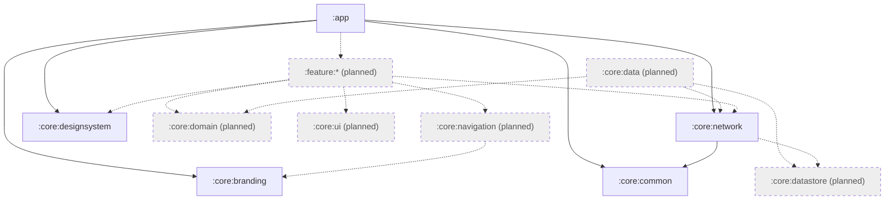

# Architecture (Phase 2)

This describes what is built after Phase 2. The full target design is in
[the design spec](superpowers/specs/2026-11-09-whitelabel-android-design.md). Anything not yet
built is marked **Planned (Phase 4)**.

## 1. Modules

| Module | Status | Role |
|---|---|---|
| `build-logic` | Built | Convention plugins (`whitelabel.android.application`, `.android.library`, `.android.library.compose`, `.jvm.library`, `.hilt`) and the validated client config loader |
| `:core:common` | Built | `Result<T, E>`, `DataError`, `ApiErrorCode`. Pure Kotlin/JVM |
| `:core:network` | Built | Ktor client factory, envelope unwrapping, error mapping, typed request helpers. Depends on `:core:common`. Pure Kotlin/JVM with Hilt |
| `:core:designsystem` | Built | Brand-resource `AppTheme`, tokens, components, design system catalog. Android library, no project dependencies |
| `:core:branding` | Built | `BrandConfig`, `Environment`, `RuntimeDefaults`. Pure Kotlin/JVM, no project dependencies |
| `:app` | Built | Application, Hilt wiring, `clientA` flavor, brand preview screen. Depends on all four core modules |
| `:core:domain`, `:core:data`, `:core:datastore`, `:core:ui`, `:core:navigation` | Planned (Phase 4) | Domain models/use cases, repositories, token and preference storage, shared UI helpers, navigation |
| `:feature:*` (auth, catalog, profile, ...) | Planned (Phase 4) | One module per feature |
| Auth plugin (bearer refresh, token storage) | Planned (Phase 4) | See section 4 |

## 2. Module dependencies

Solid arrows are real `build.gradle.kts` dependencies. Dashed arrows and grey nodes are planned.
`:core:network` does not depend on `:core:branding`: `:app` maps `BrandConfig` to `NetworkConfig`
(in `BrandModule`), so the network module knows nothing about brands or clients.
`:core:designsystem` and `:core:branding` have no project dependencies.

## 3. Client configuration

Each client lives in `clients/<id>/` (`client.properties` plus `res/` brand resources, and
`test/`). The build-logic loader validates `client.properties` and the application convention
plugin creates one flavor per client, writing the values into `BuildConfig`. Currently only
`clientA` exists (`clients/clientA/`). Debug builds use `api.debug.baseUrl`
(`http://10.0.2.2:3000/api/v1/`), release builds `api.release.baseUrl`.

## 4. Branding (section 5 of the design)

- **Identity and config (typed):** `:app` builds `BrandConfig` from `BuildConfig`
  (`brandConfigOf` / `buildConfigBrand`) and provides it as a Hilt singleton in `BrandModule`.
  `Environment` is derived from the build type (debug is `DEVELOPMENT`, release `PRODUCTION`).
  Code reads `BrandConfig`, never `BuildConfig`, and never compares client names.
- **Visuals (resources):** `:core:designsystem` declares default brand resources (color roles
  for light and dark, corner sizes, optional fonts). A client's flavor `res/` overrides them by
  resource name, with no Kotlin. `AppTheme(darkTheme)` turns them into Material 3 colors,
  shapes and typography. Dynamic color is off. `ColorContrast` supports WCAG AA contrast checks
  on color pairs.
- Components: buttons, text field, card, scaffold, loading, empty and error states, confirm
  dialog, plus a `DesignSystemCatalog` composable. `BrandPreviewScreen` in `:app` shows the theme
  and checks backend health.

## 5. Networking (section 6 of the design)

- Ktor Client with the OkHttp engine (provided by `:app`). `HttpClientFactory.create(engine,
  NetworkConfig)`; `NetworkConfig` has `baseUrl`, `clientSlug`, `userAgent`, `logger`.
- Every request carries `X-Client-Id`, `User-Agent` and `Accept: application/json`, with the
  base URL always ending in `/` so relative paths resolve under `/api/v1/`. Timeouts: 15 s
  connect, 30 s request.
- Logging is on only outside `PRODUCTION`, at headers level, with `Authorization` redacted.
- Typed helpers return `Result<T, DataError>` with the backend envelope unwrapped; paged
  responses use `Page`. Error mapping: backend error envelope gives `DataError.Api`;
  I/O failure, timeout and bad body give `DataError.Network` variants; coroutine cancellation
  is rethrown.
- Tests use Ktor `MockEngine`, so no server is needed.
- **Planned (Phase 4):** bearer auth with single-flight refresh, and encrypted token storage
  (AndroidKeyStore AES-GCM in a dedicated DataStore). Not present yet.
- Debug builds allow cleartext to `10.0.2.2`/`localhost` only; release uses the platform default.
