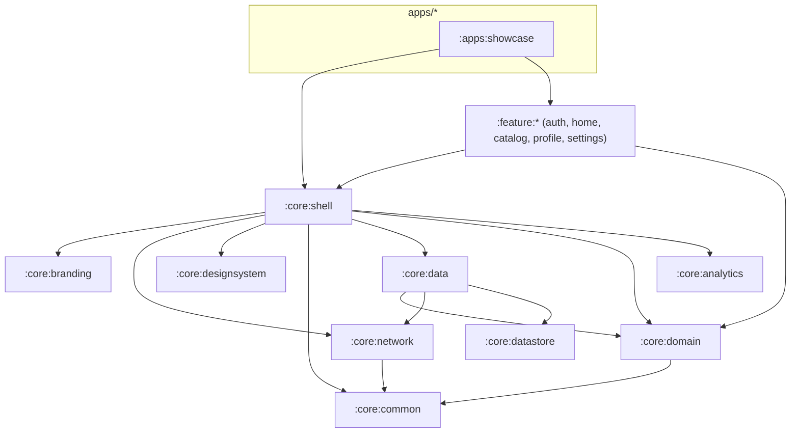

# Architecture

This repo is an **internal Android foundation for building many different apps**. Shared
modules provide the infrastructure and common features. Each app is a thin module under
`apps/<name>/` holding its configuration, its brand, the list of features it uses, and its own
business features. The design is in
[2026-11-10-reusable-app-foundation-design.md](superpowers/specs/2026-11-10-reusable-app-foundation-design.md).

## 1. Modules

| Module | Status | Responsibility |
|---|---|---|
| `build-logic` | Built | Convention plugins: `whitelabel.android.application` (app modules), `.android.library`, `.android.library.compose`, `.jvm.library`, `.koin`, and for Kotlin Multiplatform `whitelabel.kmp.library` and `whitelabel.kmp.resources` (see §6). Also the app config loader that validates each `apps/<name>/app.properties` |
| `:core:common` | Built | `Result<T, E>`, `DataError`, `ApiErrorCode`. Kotlin Multiplatform (Android, iOS) |
| `:core:presentation` | Built | Shared presentation types for Android and iOS: `UiText` (text or a shared string resource) and `DataError.toUiText()` with the generic error messages. Kotlin Multiplatform with Compose resources |
| `:core:branding` | Built | `BrandConfig`, the app's typed build-time identity (tenant, name, API URL, environment, runtime defaults). Kotlin Multiplatform (Android, iOS) |
| `:core:network` | Built | Ktor client factory, backend envelope unwrapping, error mapping, typed request helpers, the optional `X-Client-Id` tenant header, and the bearer session with single-flight refresh. It reads tokens through `SessionTokenStore`, so it never depends on storage. Kotlin Multiplatform (Android, iOS); the engine is OkHttp on Android, Darwin on iOS (`defaultHttpEngine()`) |
| `:core:designsystem` | Built | `AppTheme` built from brand resources and the app's style pack (`StylePack.Material`/`Gallery`: corners, surfaces, sizing, motion, haptics), shared-element helpers, spacing tokens, components (buttons, text field, card, scaffold, loading, empty and error states, dialog), contrast helpers |
| `:core:datastore` | Built | `JsonStore<T>`: a typed document stored as JSON on disk, which survives a corrupt file. `TokenStore`: the session tokens, encrypted with an AES-256-GCM key in AndroidKeyStore. Kotlin Multiplatform (Android, iOS) on DataStore-okio. The Keystore cipher (`KeystoreTokenCipher`) is Android-only |
| `:core:reminders` | Built | `Reminders`: local notifications at a date and time that survive reboots, clock and time-zone changes and app updates, with a 12-hour rule for missed ones; the app's channels through `ReminderConfig`; `rememberNotificationPermission()` and `openNotificationSettings()`. See [reminders.md](reminders.md) |
| `:core:reminders:shared` | Built | The reminder engine, its ports (`AlarmScheduler`, `NotificationPoster`, `ReminderStore`), `Reminder` (on `kotlinx-datetime`) and the stored format. Kotlin Multiplatform (Android, iOS) |
| `:core:shell:shared` | Built | The shell's platform-neutral model, shared with iOS: `DefinitionSpec`/`FeatureSpec` and their rules (`validate()`, the backend check), visible tabs and the start tab, the deep-link policy, and `ShellViewModel` (tabs once per process, theme, session, pending deep link). Kotlin Multiplatform (Android, iOS) |
| `:core:ios` | Built | The iOS app's entry point (`SharedGraph`): starts the shared graph with Swift-provided platform pieces and gives each shared ViewModel through a typed accessor. `:core:ios:mock` adds the fake backend in Debug. See [ios.md](ios.md) |
| `:core:shell` | Built | What every app's host needs: `FoundationApplication`, the launcher `FoundationActivity` (splash, theme), `ShellNavHost` (root navigation and bottom bar), the `appDefinition { … }` API, `BrandConfig` read from generated resources, networking setup, remote feature flags, the theme and language preferences, analytics wiring, the sign-in gate, and the diagnostics screen (debug builds only, opened from Settings) |
| `:apps:showcase` | Built | Reference app that will use every shared feature. It uses all of them: sign-in, home, catalog, profile and settings |
| `:core:domain` | Built | Cross-feature models and interfaces: `User`, `SessionState`, `SessionRepository`, `UserRepository`, `AppConfig`, `UserPreferencesRepository`, `RemoteValues` with a defaults-only implementation. Kotlin Multiplatform (Android, iOS) |
| `:core:data` | Built | Their implementations: sign-in and sign-out, the cached user, the remote app config with its cached fallback, and the theme preference. Kotlin Multiplatform (Android, iOS). `androidDataModule` (AppCompat language, Keystore cipher, store paths) is Android-only |
| `:core:ui` | Built | Android presentation helpers for features: `ObserveAsEvents`. (`UiText` lives in `:core:presentation`) |
| `:core:consent:shared` | Built | `ConsentState`, the "resolved" rule, `ConsentPort` and gathering once per launch. Kotlin Multiplatform (Android, iOS). See [firebase.md](firebase.md) |
| `:core:consent:google` | Built | Android UMP implementation of `ConsentPort`, contributed through `ModuleContributor` |
| `:core:firebase:shared` | Built | The `RemoteValues` engine over a `RemoteConfigSource`, consent-gated analytics and crash reporting, the Koin module and the fake. Kotlin Multiplatform (Android, iOS) |
| `:core:firebase:google` | Built | Android Firebase SDK: Remote Config, Analytics, Crashlytics. Linked per build type (`debugImplementation` for `firebase.enabled=debug`) |
| `:core:firebase:crashlytics` | Built | iOS only: the Kotlin crash hook over CrashKiOS. Added by the iOS app plugin when Firebase is enabled |
| `:core:analytics` | Built | `Analytics` and `CrashReporter` interfaces plus logging implementations. Kotlin Multiplatform (Android, iOS) |
| `:feature:authentication` | Built | `auth()`: the whole-app sign-in gate with sign-in, registration and password reset. See [shared-features.md](shared-features.md). Android UI: screens, the DSL function, screen strings |
| `:feature:authentication:shared` | Built | The feature's ViewModels, State/Action/Event, domain, data source, Koin module and the messages its ViewModels show. Kotlin Multiplatform (Android, iOS) |
| `:feature:settings` | Built | `settings()`: theme, language, notifications, about, legal links and sign-out. See [shared-features.md](shared-features.md). Android UI: screens, the DSL function, screen strings |
| `:feature:settings:shared` | Built | The feature's ViewModels, State/Action/Event, domain, data source, Koin module and the messages its ViewModels show. Kotlin Multiplatform (Android, iOS) |
| `:feature:profile` | Built | `profile()`: view and edit the profile, change the password. See [shared-features.md](shared-features.md). Android UI: screens, the DSL function, screen strings |
| `:feature:profile:shared` | Built | The feature's ViewModels, State/Action/Event, domain, data source, Koin module and the messages its ViewModels show. Kotlin Multiplatform (Android, iOS) |
| `:feature:home` | Built | `home()`: a greeting and the app's shortcuts to its tabs. See [shared-features.md](shared-features.md). Android UI: screens, the DSL function, screen strings |
| `:feature:home:shared` | Built | The feature's ViewModels, State/Action/Event, domain, data source, Koin module and the messages its ViewModels show. Kotlin Multiplatform (Android, iOS) |
| `:feature:catalog` | Built | `catalog()`: paginated search with categories and sort, item screen and its deep link. See [shared-features.md](shared-features.md). Android UI: screens, the DSL function, screen strings |
| `:feature:catalog:shared` | Built | The feature's ViewModels, State/Action/Event, domain, data source, Koin module and the messages its ViewModels show. Kotlin Multiplatform (Android, iOS) |
| `:apps:showcase:shared` | Built | Showcase's shared code as one iOS framework (`ShowcaseShared`, with every shared module's strings) and `showcaseSharedModules(platform)`, its Koin modules. The Swift-facing entry point comes with the iOS starter |
| `ios/WhitelabelConsent`, `ios/WhitelabelFirebase` | Built | Swift targets for UMP and Firebase (`FirebaseService`), included by an app's `project.yml` only when it uses Firebase. See [firebase.md](firebase.md) |
| `ios/WhitelabelKit`, `ios/Showcase` | Built | The Swift half: the reusable kit (bridge, platform pieces; design system, shell and screens to come) and showcase's iOS project. See [ios.md](ios.md) |
| `fixtures/standalone-app` | Built | A minimal backendless app wired like an app in its own repo; CI builds and verifies it |

**Apps in their own repo.** An app can also live in a separate repository, with this foundation as a
git submodule built from source. `gradle/foundation.settings.gradle.kts` lists the shared modules
once, for this build and for app repos. See [creating-a-standalone-app.md](creating-a-standalone-app.md).

## 2. Dependencies

Rules, enforced by module boundaries and by review:

- Shared modules (`core/*`, `feature/*`) never depend on `apps/*`, and shared features never
  depend on each other.
- An app's own feature modules (`apps/<name>/<feature>`) may depend on any shared module, never on
  another app.
- Only app modules apply `whitelabel.android.application`.
- No app's identity (name, ID, tenant, URL, color) appears outside `apps/<name>/`.
  `scripts/verify-apps.sh` also checks that no APK contains another app's application ID.

## 3. How an app is put together

1. **Build time:** the application plugin validates `apps/<name>/app.properties` and publishes
   the values twice from one map:
   - as `BuildConfig` fields, read by the app's identity test;
   - as `foundation_*` string resources, read by the shell.
2. **Startup:** `FoundationActivity` (from the shell's manifest) shows the splash from the app's
   `brand_splash_*` resources. The splash stays up while the shell fetches the remote app config,
   for at most 2 seconds. Then the visible tabs are fixed until the next launch. A config that
   arrives later is cached for the next start.
3. **UI:** the shell's decisions (which tabs show, the start tab, the gate, held deep links) come
   from `:core:shell:shared`, which works on route ids (`Tab.routeId`; the foundation's features
   use their `<Name>Routes` constants, shared with iOS). `ShellNavHost` maps them back to the app's
   tabs, registers each feature's navigation graph and starts at the start tab.
   It shows a bottom bar when two or more tabs are visible. A tab with a flag key is visible when
   the remote flag says so, or, with no remote value, when its key is in `defaults.features`.
4. **Brand visuals:** `:core:designsystem` declares default brand resources. The app's
   `src/main/res` overrides them by name, so features never change. See [branding.md](branding.md).

## 4. Dependency injection

Koin, one module per layer. Each module is a `val` next to the code it provides:

| Module | Provides |
|---|---|
| `networkModule` | the `HttpClient` |
| `dataModule` | the repositories, their stores, and the application scope (`ApplicationScope` qualifier, cancelled when the graph stops) |
| `androidDataModule` | Android's side of the data layer: `StorePaths`, `TokenCipher`, `LanguageRepository` |
| `shellModule` | `AppDefinition`, `BrandConfig`, `NetworkConfig`, the HTTP engine, analytics, the shell's ViewModels |
| `<feature>Module` | each feature's ViewModels and data sources |

- **Wiring:** a feature's DSL function passes its module in its `FeatureEntry`, and an app adds its
  own with `modules(...)` in its definition. `FoundationApplication` starts one graph from all of
  them, in this order: core layers, shell, features, the app's own modules, contributors. Koin keeps
  the last binding of a type, so an app can replace a shared binding. Screens get ViewModels with `koinViewModel()`.
- **Classpath switches:** a module that changes the graph just by being on the classpath (the mock
  backend) implements `ModuleContributor` and lists itself in
  `META-INF/services/com.whitelabel.core.network.ModuleContributor`. The shell loads it with
  `ServiceLoader`, after everything else, so its bindings win.
- **Checks:** Koin finds a missing binding only at runtime. Each module therefore has a `verify()`
  test, and each app's device test resolves every ViewModel from the real graph with
  `assertEveryViewModelResolves()`.

## 5. Networking

- **Client:** Ktor with the OkHttp engine, provided by the shell.
- **Headers:** every request carries `User-Agent` (`<applicationId>/<version>`) and
  `Accept: application/json`. `X-Client-Id` is sent only when the app sets `api.tenant`, which
  shared-mode backends need. Paths resolve under the versioned base URL.
- **Results:** typed helpers return `Result<T, DataError>` with the backend envelope unwrapped.
  Backend errors map to `DataError.Api` with the backend's `ApiErrorCode`. Cancellation is
  rethrown.
- **Logging:** only outside `PRODUCTION`, headers only, with `Authorization` redacted.
- **Cleartext:** debug builds may use cleartext to `10.0.2.2` and `localhost` only. Release builds
  never do.
- **Session:** while signed in, requests carry `Authorization: Bearer`, following the backend's
  "Android client guidance":
  - A 401 `TOKEN_EXPIRED` or `UNAUTHENTICATED` triggers one refresh, shared by every concurrent
    caller, then one retry.
  - A rejected refresh, or a retry that is still rejected, ends the session.
  - A refresh that gets no response is retried once at once with the same token, as the backend
    requires; if it still fails, the session is kept.
  - Every other 401 (such as `INVALID_CREDENTIALS` for a wrong password) is returned untouched.
  - Token writes are conditional on the pair the request used, so a refresh that lands after
    sign-out never signs the user back in.
  - Requests marked `publicRequest()` (sign-in, registration) never carry the bearer.

See [api-environments.md](api-environments.md).

## 6. Kotlin Multiplatform

The foundation is moving to Kotlin Multiplatform so apps can ship on iOS with the same logic: rules,
data and ViewModels are shared, and each platform draws its own UI (Jetpack Compose on Android,
SwiftUI on iOS). Design: [2026-11-11-ios-kmp-stack-design.md](superpowers/specs/2026-11-11-ios-kmp-stack-design.md);
progress: [2026-11-11-kmp-migration.md](superpowers/plans/2026-11-11-kmp-migration.md).

- **`whitelabel.kmp.library`** builds a module for:
  - Android, with AGP's `com.android.kotlin.multiplatform.library`;
  - iOS (`iosArm64`, `iosSimulatorArm64`);
  - the JVM. The JVM target ships nowhere. It runs host tests on plain JUnit 5 and lets the
    JVM-only `:core:testing` fixtures be used from `jvmTest`.

  The namespace and package come from the Gradle path (`:core:common` →
  `com.whitelabel.core.common`).
- **Platform seams.** Shared code reaches the platform only through these. Android implements each
  in the foundation; on iOS the iOS starter provides them (Swift where an Apple SDK is needed):

  | Seam | Android | iOS |
  |---|---|---|
  | `StorePaths` (where stores live) | `filesDir/datastore/<name>.json` | `iosJsonStorePath(name)`: Application Support |
  | `TokenCipher` | `KeystoreTokenCipher` (AES-GCM, AndroidKeyStore) | CryptoKit + Keychain (iOS starter) |
  | `LanguageRepository` | `AppCompatLanguageRepository` | iOS starter |
  | `defaultHttpEngine()` | OkHttp | Darwin |
  | `AlarmScheduler`, `NotificationPoster` | `:core:reminders` | `UNUserNotificationCenter` (iOS starter) |

- **Source sets:**
  - `commonMain` holds everything that isn't platform code.
  - `androidMain` and `iosMain` hold only adapters behind interfaces.
  - Tests live in `commonTest` (all targets), `jvmTest`, `androidDeviceTest` (code that needs a
    `Context`) and `iosTest`.
- **Features are two modules.** `:feature:<name>` is a plain Android library: screens, the
  `AppDefinitionBuilder.<name>()` function, screen-only strings, device tests.
  `:feature:<name>:shared` holds everything else and is what iOS uses. The Android module depends
  on it with `api`, so apps keep depending on `:feature:<name>` only.
- **An app's iOS framework** is a KMP module (`:apps:<name>:shared`) that exports the shared
  modules Swift calls and lists their Koin modules (see `showcaseSharedModules`).
- **`whitelabel.kmp.resources`** adds Compose Multiplatform resources. Strings shared code shows go
  in `src/commonMain/composeResources/values{,-fr}/strings.xml`, and the generated `Res` lives in
  `<namespace>.resources`.
  - Write apostrophes plainly (`'`): Compose resources don't unescape Android's `\'`.
  - Strings that only screens use stay in each platform's own resources.

## 7. Further reading

- [creating-an-app.md](creating-an-app.md): build app #N step by step
- [firebase.md](firebase.md): remote values, analytics, crash reports and consent
- [adding-a-shared-feature.md](adding-a-shared-feature.md): add a reusable feature
- [branding.md](branding.md), [api-environments.md](api-environments.md),
  [release-signing.md](release-signing.md), [testing.md](testing.md)
