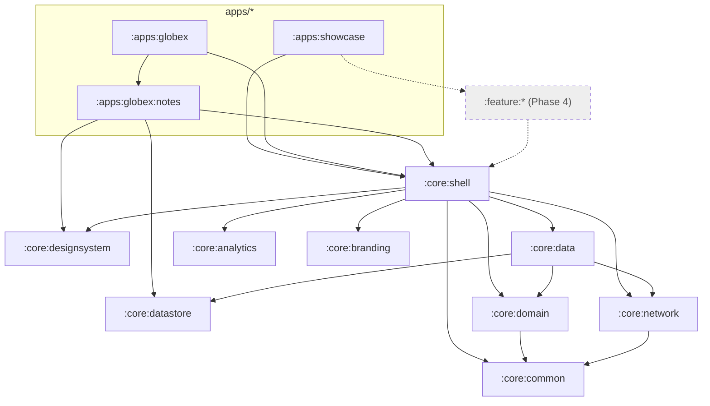

# Architecture

This repo is an **internal Android foundation for building many different apps**. Shared
modules provide the infrastructure and common features. Each app is a thin module under
`apps/<name>/` holding its configuration, its brand, the list of features it uses, and its own
business features. The design is in
[2026-11-10-reusable-app-foundation-design.md](superpowers/specs/2026-11-10-reusable-app-foundation-design.md).
Items marked **Phase 4** are not built yet.

## 1. Modules

| Module | Status | Responsibility |
|---|---|---|
| `build-logic` | Built | Convention plugins: `whitelabel.android.application` (app modules), `.android.library`, `.android.library.compose`, `.jvm.library`, `.hilt`. Also the app config loader that validates each `apps/<name>/app.properties` |
| `:core:common` | Built | `Result<T, E>`, `DataError`, `ApiErrorCode`. Pure Kotlin |
| `:core:branding` | Built | `BrandConfig`, the app's typed build-time identity (tenant, name, API URL, environment, runtime defaults). Pure Kotlin |
| `:core:network` | Built | Ktor client factory, backend envelope unwrapping, error mapping, typed request helpers, the optional `X-Client-Id` tenant header, and the bearer session with single-flight refresh. It reads tokens through `SessionTokenStore`, so it never depends on storage. Pure Kotlin with Hilt |
| `:core:designsystem` | Built | `AppTheme` built from brand resources, spacing tokens, components (buttons, text field, card, scaffold, loading, empty and error states, dialog), contrast helpers |
| `:core:datastore` | Built | `JsonStore<T>`: a typed document stored as JSON on disk, which survives a corrupt file. `TokenStore`: the session tokens, encrypted with an AES-256-GCM key in AndroidKeyStore |
| `:core:shell` | Built | What every app's host needs: `FoundationApplication`, the launcher `FoundationActivity` (splash, theme), `ShellNavHost` (root navigation and bottom bar), the `appDefinition { … }` API, `BrandConfig` read from generated resources, networking setup, remote feature flags and the theme preference, analytics wiring, and the `diagnostics()` feature |
| `:apps:showcase` | Built | Reference app that will use every shared feature. Today: sign-in and diagnostics |
| `:apps:globex`, `:apps:globex:notes` | Built | Second app, proving reuse: sign-in, an app-specific notes feature, and diagnostics |
| `:core:domain` | Built | Cross-feature models and interfaces: `User`, `SessionState`, `SessionRepository`, `UserRepository`, `AppConfig`, `UserPreferencesRepository`. Pure Kotlin |
| `:core:data` | Built | Their implementations: sign-in and sign-out, the cached user, the remote app config with its cached fallback, and the theme preference |
| `:core:ui` | Built | Presentation helpers for features: `UiText`, `DataError.toUiText()`, `ObserveAsEvents` |
| `:core:analytics` | Built | `Analytics` and `CrashReporter` interfaces plus logging implementations. Pure Kotlin |
| `:feature:authentication` | Built | `auth()`: the whole-app sign-in gate with sign-in, registration and password reset. See [shared-features.md](shared-features.md) |
| `:feature:home`, `catalog`, `profile`, `settings` | Phase 4 | Ready-to-use shared features against the backend-starter API |
| `fixtures/standalone-app` | Built | A minimal backendless app wired like an app in its own repo; CI builds and verifies it |

**Apps in their own repo.** An app can also live in a separate repository, with this foundation as a
git submodule built from source. `gradle/foundation.settings.gradle.kts` lists the shared modules
once, for this build and for app repos. See [creating-a-standalone-app.md](creating-a-standalone-app.md).

## 2. Dependencies

Rules, enforced by module boundaries and by review:

- Shared modules (`core/*`, `feature/*`) never depend on `apps/*`, and shared features never
  depend on each other.
- An app's own feature modules (`apps/<name>/<feature>`) may depend on any shared module, never on
  another app.
- Only app modules apply `whitelabel.android.application`.
- No app's identity (name, ID, tenant, URL, color) appears outside `apps/<name>/`.
  `scripts/verify-apps.sh` also checks that no APK contains another app's application ID.

## 3. How an app is put together

1. **Build time:** the application plugin validates `apps/<name>/app.properties` and publishes
   the values twice from one map:
   - as `BuildConfig` fields, read by the app's identity test;
   - as `foundation_*` string resources, read by the shell.
2. **Startup:** `FoundationActivity` (from the shell's manifest) shows the splash from the app's
   `brand_splash_*` resources. The splash stays up while the shell fetches the remote app config,
   for at most 2 seconds. Then the visible tabs are fixed until the next launch. A config that
   arrives later is cached for the next start.
3. **UI:** `ShellNavHost` registers each feature's navigation graph and starts at the start tab.
   It shows a bottom bar when two or more tabs are visible. A tab with a flag key is visible when
   the remote flag says so, or, with no remote value, when its key is in `defaults.features`.
4. **Brand visuals:** `:core:designsystem` declares default brand resources. The app's
   `src/main/res` overrides them by name, so features never change. See [branding.md](branding.md).

## 4. Networking

- **Client:** Ktor with the OkHttp engine, provided by the shell.
- **Headers:** every request carries `User-Agent` (`<applicationId>/<version>`) and
  `Accept: application/json`. `X-Client-Id` is sent only when the app sets `api.tenant`, which
  shared-mode backends need. Paths resolve under the versioned base URL.
- **Results:** typed helpers return `Result<T, DataError>` with the backend envelope unwrapped.
  Backend errors map to `DataError.Api` with the backend's `ApiErrorCode`. Cancellation is
  rethrown.
- **Logging:** only outside `PRODUCTION`, headers only, with `Authorization` redacted.
- **Cleartext:** debug builds may use cleartext to `10.0.2.2` and `localhost` only. Release builds
  never do.
- **Session:** while signed in, requests carry `Authorization: Bearer`, following the backend's
  "Android client guidance":
  - A 401 `TOKEN_EXPIRED` or `UNAUTHENTICATED` triggers one refresh, shared by every concurrent
    caller, then one retry.
  - A rejected refresh, or a retry that is still rejected, ends the session.
  - A refresh that gets no response is retried once at once with the same token, as the backend
    requires; if it still fails, the session is kept.
  - Every other 401 (such as `INVALID_CREDENTIALS` for a wrong password) is returned untouched.
  - Token writes are conditional on the pair the request used, so a refresh that lands after
    sign-out never signs the user back in.
  - Requests marked `publicRequest()` (sign-in, registration) never carry the bearer.

See [api-environments.md](api-environments.md).

## 5. Further reading

- [creating-an-app.md](creating-an-app.md): build app #N step by step
- [adding-a-shared-feature.md](adding-a-shared-feature.md): add a reusable feature
- [branding.md](branding.md), [api-environments.md](api-environments.md),
  [release-signing.md](release-signing.md), [testing.md](testing.md)
