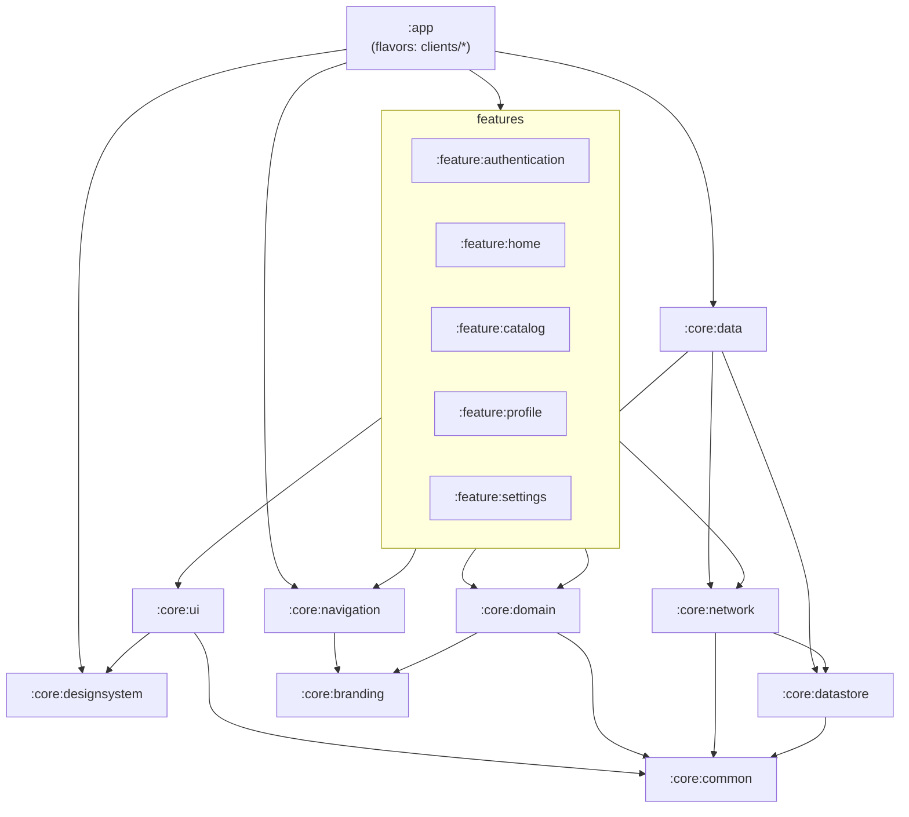

# White-Label Android Starter Kit — Architecture Design (Phase 1)

Status: **awaiting architectural approval** (brief §15). Date: 2026-11-09.
Brief: [2026-11-09-whitelabel-android-brief.md](./2026-11-09-whitelabel-android-brief.md).
Backend contract source: `../backend-api/docs/superpowers/specs/2026-11-09-whitelabel-backend-design.md` §9.

Items marked **(call)** are decisions I made where the brief left a choice. Each one can be changed.

---

## 0. Intent

One Kotlin/Compose codebase. Every client is one directory under `clients/` holding a
properties file and a `res/` folder. Gradle turns each directory into a `client` product
flavor, so `assembleClientARelease` produces an app with its own application ID, name, icon,
splash screen, colors, fonts, API base URL and tenant slug. Feature modules have no flavors
and never branch on the client. They receive a typed `BrandConfig` through Hilt, and they
read colors and fonts through `AppTheme`.

**Non-goals (initial scope):** social login, push notifications, offline-first sync for
every feature, dynamic delivery, iOS/KMP, applying the backend's runtime `branding`
overrides (build-time branding wins; see §5).

---

## 1. Module structure and why each exists

**(call)** One module per feature, with `presentation/`, `domain/` and `data/` packages
inside it. I chose this over the three-modules-per-feature split (`:feature:x:domain/data/presentation`).
Five features would otherwise mean 15 modules plus build config, and nothing here needs to
consume a feature's domain layer without its UI. Layer rules are still enforced: `presentation`
code depends only on interfaces declared in `domain`, and Hilt binds the `data`
implementations. A feature that grows can be split later without touching other features.

| Module | Kind | Why it exists | Created in |
|---|---|---|---|
| `:app` | Android app | The only module with flavors. Owns `clients/*` wiring, `BuildConfig` → `BrandConfig`, Hilt `@HiltAndroidApp`, `MainActivity`, splash, root `NavHost`, bottom bar | Phase 2 |
| `:build-logic` | included build | Convention plugins, plus `ClientConfigLoader`, which parses and validates `clients/*/client.properties` | Phase 2 |
| `:core:common` | pure Kotlin | `Result<D, E>`, `Error`, `DataError`, `ApiErrorCode`: shared by every layer | Phase 2 |
| `:core:branding` | pure Kotlin | Typed `BrandConfig`, `Environment`, `RuntimeDefaults`: what a client *is*, with no Android types | Phase 2 |
| `:core:network` | pure Kotlin + Hilt | Ktor `HttpClient` factory, backend envelope DTOs, error mapping, `getResult`/`postResult` helpers; later the bearer/refresh plugin | Phase 2 (auth in 4) |
| `:core:designsystem` | Android + Compose | `AppTheme` built from brand resources, tokens (spacing/shape/type), components, catalog screen | Phase 2 |
| `:core:ui` | Android + Compose | `UiText`, `DataError.toUiText()`, `ObserveAsEvents`: presentation helpers shared by features | Phase 4 |
| `:core:navigation` | Android | `DeepLinks` (scheme from `BrandConfig`), `TopLevelDestination` model, protected-route helpers | Phase 4 |
| `:core:datastore` | Android | Preferences DataStore (theme, language, notifications, cached app config) and the Keystore-encrypted token store | Phase 4 |
| `:core:domain` | pure Kotlin | Cross-feature models and interfaces: `User`, `SessionState`, `SessionRepository`, `AppConfig`, `UserPreferences` | Phase 4 |
| `:core:data` | Android | Implementations of the `:core:domain` interfaces (they span network + datastore, so no single feature can own them) | Phase 4 |
| `:core:database` | Android | **Deferred (call).** Room is "when necessary"; no requirement needs it yet. The catalog offline cache is the first candidate, decided in the Phase 4 plan | if needed |
| `:feature:authentication` | Android feature | Login, register, forgot/reset password screens and their data sources | Phase 4 |
| `:feature:home` | Android feature | Dashboard | Phase 4 |
| `:feature:catalog` | Android feature | Paginated list, search/filter/sort, details | Phase 4 |
| `:feature:profile` | Android feature | View/edit profile, change password | Phase 4 |
| `:feature:settings` | Android feature | Theme, language, notifications, about, legal links, logout | Phase 4 |

Changes from the brief's suggested list: added `:core:domain` and `:core:data`, because
features never depend on each other and `User` and session are shared by home, profile and
settings. Added `:build-logic`. Deferred `:core:database`. Modules are created in the phase
that first gives them real content, never as empty shells.

---

## 2. Module dependencies



Rules (checked in review; module boundaries make a violation a compile error):
- Features never depend on other features. Cross-feature navigation is a lambda that `:app` supplies.
- Nothing depends on `:app`. Only `:app` knows the client.
- `:core:common` and `:core:branding` are pure Kotlin and have no dependencies.
- `:core:network` does not know about branding. `:app` maps `BrandConfig` → `NetworkConfig`.
- Feature `data` packages may use `:core:network`. Feature `presentation` code sees only feature `domain` interfaces and `:core:domain`.

---

## 3. Client configuration (how a client is defined)

```
clients/
  clientA/
    client.properties        # build-time config, validated at configuration time
    res/                     # overrides: icon, splash, brand colors, fonts, corner radii
      mipmap-anydpi-v26/ic_launcher.xml, ic_launcher_round.xml
      drawable/ic_launcher_foreground.xml, ic_launcher_monochrome.xml, brand_splash_icon.xml
      values/brand.xml       # brand_splash_background, ic_launcher_background, brand_light_*, brand_dark_*, brand_corner_*
      font/brand_display.ttf, brand_body.ttf   (optional)
    test/                    # per-client expectation tests (testClientA source set)
    signing.properties       # gitignored; release signing for this client only
```

`client.properties` (exact keys):

| Key | Example (clientA) | Validation |
|---|---|---|
| `client.slug` | `acme` | backend `SLUG_PATTERN` `^[a-z0-9][a-z0-9-]{1,62}$`; sent as `X-Client-Id` |
| `app.applicationId` | `com.whitelabel.acme` | Java package syntax, unique across clients |
| `app.name` | `Acme` | non-blank |
| `app.versionCode` | `1` | integer 1..2100000000 |
| `app.versionName` | `1.0.0` | non-blank |
| `app.deepLinkScheme` | `acme` | `^[a-z][a-z0-9+.-]*$`, unique across clients |
| `api.debug.baseUrl` | `http://10.0.2.2:3000/api/v1/` | absolute http(s) URL; trailing `/` added if missing |
| `api.release.baseUrl` | `https://api.platform.example.com/api/v1/` | must be `https`, host not `localhost`/`127.0.0.1`/`10.0.2.2` |
| `defaults.support.email` | `support@acme.example` | optional |
| `defaults.legal.privacyPolicyUrl` | `https://acme.example/privacy` | https |
| `defaults.legal.termsUrl` | `https://acme.example/terms` | https |
| `defaults.features` | `catalog,profile` | comma list of feature keys enabled when remote config is unavailable |

The flavor name is the directory name. It must match `^[a-z][a-zA-Z0-9]*$`, must not be
`main`, `debug` or `release`, and must not start with `test` or `androidTest`. Every problem
in every client is reported in one `GradleException` naming the file and key, so a broken
client fails `./gradlew` immediately.

**Environment (call):** the environment comes from the build type: `debug` → `DEVELOPMENT`,
`release` → `PRODUCTION`. That gives clients × 2 variants, exactly the variants the brief
lists. Debug builds get `applicationIdSuffix = ".debug"` so both builds install side by side.
Adding staging later means one `staging` build type (`initWith(release)`) plus an
`api.staging.baseUrl` key, not a second flavor dimension.

### Three configuration levels

| Level | Source | Lives in | Available when |
|---|---|---|---|
| Build-time | `client.properties` + `res/` | `BuildConfig`, resources → `BrandConfig` (Hilt singleton) | always, offline, before first frame |
| Runtime | `GET /api/v1/app/config` (public, `X-Client-Id`) | `:core:data` `AppConfigRepository`, cached in DataStore | cached copy, else `BrandConfig.runtimeDefaults` |
| User preferences | user choice | `:core:datastore` (source of truth), best-effort sync to `PATCH /settings` when signed in | always |

Remote config never blocks startup. `AppConfigRepository.config: Flow<AppConfig>` first
emits the cache, falling back to build-time defaults, then refreshes in the background. A
failed fetch keeps the last good value. The backend's optional `branding` block is ignored
on purpose: the brief says build-time branding must not depend on the API.

---

## 4. How Gradle flavors scale

- `whitelabel.android.application` (convention plugin, applied only in `:app`) calls
  `ClientConfigLoader.load(rootDir/clients)` and registers one flavor per directory in
  dimension `client`. No client is named in any Gradle file.
- Per flavor it sets `applicationId`, `versionCode`, `versionName`, `resValue("string","app_name")`,
  `manifestPlaceholders["deepLinkScheme"]`, `res.srcDir(clients/<id>/res)` and
  `java.srcDir(clients/<id>/test)` for `test<Flavor>`.
- Per variant (`androidComponents.onVariants`) it adds `BuildConfig` fields from the
  flavor × build type: `CLIENT_SLUG`, `APP_NAME`, `API_BASE_URL`, `ENVIRONMENT`,
  `DEEP_LINK_SCHEME`, `SUPPORT_EMAIL`, `PRIVACY_POLICY_URL`, `TERMS_URL`, `DEFAULT_FEATURES`.
- Library modules have no flavors, so adding the 30th client adds 2 variants to `:app` and
  zero to everything else. Library code is compiled once and shared by every client.
- Per-client signing comes from the gitignored `clients/<id>/signing.properties`. If that file
  is missing, the release build stays unsigned: assembling still works, but distributing
  needs keys. CI writes the file from secrets.

## 5. How branding is injected

**Identity and config (typed):** `:app` builds `BrandConfig` from `BuildConfig` in
`BrandModule` and provides it as a Hilt singleton. Features inject `BrandConfig` (or receive
values from `:app` as nav-graph parameters). No feature reads `BuildConfig`, and no feature
compares client names.

**Visuals (resources) (call):** `:core:designsystem` declares the brand resource contract
with defaults: 21 color roles × light/dark (`brand_light_primary` … `brand_dark_outline`),
`brand_corner_small|medium|large`, and optional fonts `brand_display`/`brand_body`. Android
resource merging lets the app's flavor `res/` override library resources with the same name,
so a client changes colors by overriding `res/values/brand.xml` with no Kotlin at all.
`AppTheme(darkTheme)` reads those resources into a Material 3 `ColorScheme`, `Shapes` and
`Typography`. Light and dark are separate named resources rather than `values-night`, so the
in-app theme choice (light/dark/system) works no matter what the OS setting is. Dynamic color
is off, so brand colors always apply. Fonts: if the client ships `res/font/brand_display`, it
is used; otherwise the system font is. The lookup is by name, once, and the files are kept
from resource shrinking with `tools:keep`.

**Required per client** (the build fails without them): `ic_launcher`, `ic_launcher_round`,
`brand_splash_icon`, `brand_splash_background`, `ic_launcher_background`. **Optional:**
everything else, which falls back to the design system defaults. An instrumented
`BrandContrastTest` runs per variant and fails if any `on*`/container color pair is below
WCAG AA 4.5:1 in light or dark.

## 6. How networking is configured

- **Ktor Client (call)** with the OkHttp engine, over Retrofit. The backend wraps every
  response in an envelope (`{success, data, meta}` / `{success:false, error{code,…}}`), and
  Ktor's plugin pipeline handles envelope unwrapping, the `X-Client-Id` header and the
  bearer refresh with single-flight in one place. Tests use `MockEngine` and need no server.
- `:core:network` exposes `HttpClientFactory.create(engine, NetworkConfig)`. `NetworkConfig`
  holds `baseUrl`, `clientSlug`, `userAgent` and `logger`. `:app` builds it from `BrandConfig`,
  and logging is enabled only outside `PRODUCTION`, with `Authorization` redacted.
- Every request gets `defaultRequest { url(baseUrl); header("X-Client-Id", slug); Accept: JSON }`.
  Feature code passes relative paths only (`"catalog"`). A leading `/` is stripped, because
  Ktor would otherwise resolve `/catalog` against the host root and drop `/api/v1`.
- The typed helpers `getResult`, `getPageResult`, `postResult`, `patchResult` and `deleteResult`
  return `Result<T, DataError>`, with the envelope already unwrapped. Error mapping:

| Situation | `DataError` |
|---|---|
| backend error envelope | `DataError.Api(code = ApiErrorCode.fromWire(error.code), httpStatus, fieldErrors, retryAfterSeconds)` |
| non-envelope error body (proxy HTML, empty) | `DataError.Api(ApiErrorCode.fromStatus(status), status)` |
| `IOException` / unresolved host / refused | `DataError.Network.NO_INTERNET` |
| timeout | `DataError.Network.REQUEST_TIMEOUT` |
| malformed success body | `DataError.Network.SERIALIZATION` |
| `CancellationException` | **rethrown**, never mapped |

- **Auth (Phase 4):** Ktor `Auth { bearer { loadTokens; refreshTokens; sendWithoutRequest } }`.
  Ktor runs one refresh at a time and parks concurrent 401s, which is the single-flight the
  backend requires (it revokes the session when a refresh token is reused more than 10 s
  later). The refresh request itself is excluded from auth. If refresh fails with
  `INVALID_REFRESH_TOKEN`, tokens are cleared, `SessionState` becomes `Unauthenticated`,
  and the root nav moves to the auth graph.
- **Token storage (Phase 4):** an AES-256-GCM key in AndroidKeyStore encrypts the token pair,
  and the ciphertext and IV are stored in a dedicated DataStore file that is excluded from
  backup. If decryption fails (key invalidated, data restored onto a new device), the app
  treats the user as signed out and clears the store. `security-crypto`/EncryptedSharedPreferences
  is deprecated and not used.
- **Debug only:** a cleartext exception for `10.0.2.2`/`localhost` lives in `src/debug`
  network security config. Release builds use the platform default (cleartext blocked).

## 7. How API contracts are consumed

- The backend commits a generated `openapi/openapi.json` (OpenAPI 3.1). This repo vendors a
  copy at `api/openapi.json` plus `api/SOURCE` (backend commit SHA). `scripts/sync-openapi.sh`
  refreshes both. In Phase 5, CI fails when the vendored copy is older than the SHA recorded
  for the release.
- **(call) DTOs are handwritten** `@Serializable` classes in each feature's `data` package,
  using `ignoreUnknownKeys = true` so additive backend changes do not break old apps.
  Generated clients (openapi-generator) were rejected because they ignore the envelope, add
  their own serialization stack, and produce more code than the DTOs they replace. Contract
  drift is caught by **contract tests**: each DTO test decodes the JSON examples from the
  vendored spec.
- `docs/api-integration.md` (Phase 5) lists endpoints, models, auth, errors and pagination.
  Pagination follows the backend: `page` ≥ 1, `pageSize` 1–100 (default 20),
  `meta.pagination{page,pageSize,totalItems,totalPages}`, and a page past the end returns
  empty `data`.
- **Mock backend (call):** primary development runs against the real backend
  (`../backend-api`, `docker compose up` + `npm run dev`; the seed creates tenants `acme` and
  `globex`). For work without the backend, `-Pwhitelabel.mockApi=true` makes debug builds bind
  a Ktor `MockEngine` with fixture responses. That code lives in `app/src/debug/`, so release
  builds cannot contain it. Tests use `MockEngine` directly.

## 8. Sample clients

| Flavor | Slug | Backend mode | Release base URL | Look |
|---|---|---|---|---|
| `clientA` | `acme` | shared | `https://api.platform.example.com/api/v1/` | green primary, rounded, system font |
| `clientB` | `globex` | dedicated | `https://api.globex.example.com/api/v1/` | blue primary, square corners, bundled display font |

Both debug builds point at `http://10.0.2.2:3000/api/v1/` (the local backend in shared mode
serves both tenants).

## 9. Technology baseline (call)

A known-compatible matrix. Every version is a stable release older than two weeks. Gradle
8.13 and AGP 8.13.2 are already in the local cache.

| Tool | Version | | Library | Version |
|---|---|---|---|---|
| Gradle | 8.13 | | Compose BOM | 2025.10.01 |
| AGP | 8.13.2 | | Navigation Compose | 2.9.5 |
| Kotlin | 2.2.20 | | Lifecycle | 2.9.4 |
| KSP | 2.2.20-2.0.3 | | Activity Compose | 1.11.0 |
| Hilt | 2.57.2 | | Hilt Navigation Compose | 1.3.0 |
| JDK | 17 | | Ktor | 3.3.1 |
| compile/target SDK | 36 | | kotlinx-serialization | 1.9.0 |
| min SDK | 26 | | Coroutines | 1.10.2 |
| | | | DataStore | 1.1.7 |
| | | | core-ktx / core-splashscreen | 1.17.0 / 1.0.1 |
| | | | JUnit 5 / android-junit5 plugin | 5.13.4 / 1.13.1.0 |
| | | | AssertK / Turbine | 0.28.1 / 1.2.1 |

minSdk 26 means adaptive icons everywhere, so each client needs only vector icon assets
and no PNG density buckets.

**Coding conventions** follow the installed `android-*` skills (Result/DataError,
data-source naming, MVI State/Action/Event, Root/Screen split, type-safe nav with callbacks,
fakes over mocks, JUnit5 + AssertK + Turbine). There are two deliberate deviations,
because the brief overrides the skills: **Hilt instead of Koin**, and one module per feature (§1).

## 10. Testing strategy (summary)

- **JVM unit (JUnit5):** `:core:common`, `:core:network` (MockEngine), `:build-logic`
  (`ClientConfigLoader`), ViewModels/use cases/repositories with fakes (Phase 4).
- **Per-client variant tests:** `clients/<id>/test/*` runs in `testClient<X>DebugUnitTest` and
  asserts exact `BrandConfig` values. `scripts/verify-variants.sh` checks each built APK with
  `aapt2 dump badging` (package, label), confirms the launcher icons differ, and confirms that
  no APK contains another client's application ID.
- **Instrumented (emulator `Medium_Phone_API_36.1`):** design system components, brand
  contrast per variant, and in Phase 4/5 navigation, auth flow and screen tests (Robot pattern).
- **CI (Phase 5):** GitHub Actions matrix over clients: assemble debug+release, unit tests,
  lint, variant verification; instrumented tests on an emulator job.

## 11. Implementation roadmap

| Phase | Branch | Deliverable | Plan |
|---|---|---|---|
| 1 Architecture | — | this document | approved → next |
| 2 Foundation | `feat/foundation` | Gradle + build-logic + client loader, `:core:common`, `:core:network`, `:core:branding`, `:core:designsystem`, `:app` running as clientA | `plans/2026-11-09-whitelabel-android-foundation.md` |
| 3 Multi-client | `feat/multi-client` (from `main` after Phase 2 merges) | clientB, per-client tests, APK verification script, signing, client onboarding + branding docs | same plan |
| 4 Core features | `feat/<feature>` each | `:core:domain/data/datastore/ui/navigation`, auth (tokens, refresh, protected nav), home, catalog, profile, settings | written after Phase 3 checkpoint |
| 5 Integration & quality | `feat/integration`, `ci/github-actions` | mock backend, contract tests, E2E tests, CI workflows, full docs | written after Phase 4 |

Phases 4–5 get their own plan after Phase 3. By then the backend has finished its auth and
modules phases and generated `openapi.json`, so the Android DTOs can be written against the
real contract instead of a guess.

Each phase ends with a checkpoint: tests green, all variants build, docs updated, a report,
and **a wait for approval**.

## Approaches considered

**Client definition**
- **A. Directory per client + properties + res, flavors generated by build-logic (chosen).**
  Onboarding adds one folder, and Gradle files never change.
- B. Flavors hand-written in `app/build.gradle.kts`. Simple at 2 clients, but every client
  edits shared build code, which causes merge conflicts.
- C. One generic APK configured at runtime. Rejected: each client needs its own application
  ID, icon and store listing.

**Brand visuals**
- **A. Resource overrides with design-system defaults (chosen).** Data-only, previewable, and
  supports light/dark per client.
- B. A Kotlin `BrandTheme` object per client in a flavor source set. Typed, but every client
  carries code and needs Kotlin review.
- C. Seed color + generated tonal palette (material-color-utilities). Less control over exact
  brand hues, and it adds a dependency.

**Environment**
- **A. Build type = environment (chosen).** 2 variants per client.
- B. A second flavor dimension (`dev`/`staging`/`prod`). 6 variants per client, most never built.
