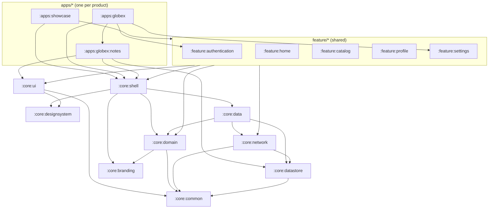

# Reusable Android App Foundation — Design

Status: **awaiting approval**. Date: 2026-11-10.
Supersedes: the white-label parts of
[2026-11-09-whitelabel-android-design.md](./2026-11-09-whitelabel-android-design.md) (§0, §3, §4,
§8 and the Phase 3+ roadmap). Everything else in that design still holds unless this document
changes it.

---

## 0. Intent and the why

This repo stops being "one app shipped under many brands" and becomes an **internal Android
foundation for building many different apps**. The owner wants to invest once in infrastructure
and common features (networking, auth, storage, navigation, design system, settings, and so on)
so that each new app is mostly its own business features, branding and configuration.

**Success measure:** how quickly and cleanly app #2, #3, … get built. Concretely, a new app
starts as ~5 small files plus its business features, with no edits to shared modules and no
copy-paste of infrastructure.

### Decisions the owner made (2026-11-10)

| Question | Decision |
|---|---|
| Will apps share one backend? | **No.** Each app has its own backend, but every backend is built from the same starter as `../backend-api` (same envelope, error codes, auth endpoints, pagination, app-config/feature flags). Shared modules target that contract directly ("ready to use"). |
| Brand variants of one app (Acme/Globex style)? | **Not needed.** One app = one brand. The `client` flavor dimension goes away. |
| Where do new apps live? | **In this repo**, under `apps/<name>/`, built and tested together. No library publishing. |
| How thin is an app module? | **Approach A**: a shared app shell plus an explicit, readable feature list per app (see Approaches). |
| What does signing in gate? | **The whole app.** A signed-out user sees only the auth screens; after sign-in, the full app. Guest mode (public features, sign-in on demand) is a non-goal. |

### Goals
- **App module stays tiny.** A new app is config, resources, one composition file and its own feature modules.
- **Ready-to-use features.** Shared features (auth, home, catalog, profile, settings) work against any backend made from the backend starter. Each has a small public API and host-configurable options.
- **Shared code knows no app.** Nothing app-specific lives in shared modules: no app names, URLs, colors or `if (app == …)`.
- **Tested together.** A change to a shared module is built and tested against every app in the same PR.
- **Extractable modules.** Modules could be extracted or published later without redesign: no reach-ins, explicit dependencies, public API kept small (`internal` by default).

### Non-goals
- Brand variants of a single app.
- Pluggable or adapter layers for backends that don't follow the backend starter. Such an app writes its own data layer against the shared `HttpClient`.
- Publishing modules to a Maven repository.
- Splitting apps into separate repos.
- An onboarding feature. It is a candidate shared feature for later, not built now.
- Guest mode, where some features are public and sign-in happens on demand.

### Anti-goals (a failure even if it works)
- A new app needs edits inside `core/` or `feature/` to exist.
- Features find each other through reflection or auto-registration, so the app's composition can't be read in one file.
- Copying the shell's Activity or navigation into each app.
- Abstractions with one implementation and no reason to exist.

---

## 1. What exists today and what changes

Today (PR #1, `feat/foundation`) the repo has these parts.

**Reusable as-is:**
- `:core:common` (Result, DataError, ApiErrorCode)
- `:core:network` (Ktor client with envelope unwrapping and error mapping)
- `:core:designsystem` (theme from brand resources, components, contrast checks)
- `:core:branding` (typed `BrandConfig`)
- the validation logic in build-logic's client loader

**Coupled to the old model:**
- `:app` is a single application module, and every `clients/<x>/` folder becomes one of its flavors.
- `BuildConfig` → `BrandConfig` mapping, the preview screen and the Hilt wiring live in `:app`, so app #2 would have to copy them.
- `clients/clientA` is the only app definition.

**Change summary:**
1. `clients/<x>/` + the `client` flavor dimension → `apps/<name>/` application modules. Each module reads its own `app.properties`.
2. New `:core:shell` takes the host code out of `:app`: Application base, Activity, splash, theme, root navigation, bottom bar, and `BrandConfig` provisioning.
3. A small, explicit composition API (`AppDefinition`) lets each app declare its features and tabs.
4. The current clientA (Acme) becomes `apps/showcase`, the reference app that uses every shared feature. A second app, `apps/globex`, proves reuse: a different feature subset plus one app-specific feature.
5. The old plan's Phase 3 (clientB, per-client signing, `verify-variants.sh`, onboarding docs) is replaced by the multi-app phase below. Phase 4 builds the shared features against the new API.

Working code is moved, not rewritten. The loader's validation rules, the network client, the
design system and the tests keep their behaviour.

---

## 2. Target structure

```
apps/
  showcase/                    :apps:showcase   reference app, uses every shared feature
    app.properties             build-time identity + API (validated)
    build.gradle.kts           plugins + the shared features it uses
    src/main/kotlin/…/ShowcaseApp.kt         @HiltAndroidApp class extending FoundationApplication
    src/main/kotlin/…/ShowcaseDefinition.kt  the composition: features + tabs
    src/main/res/              icon, splash, brand.xml colors, optional fonts
    src/test/…                 identity test (exact config values)
  globex/                      :apps:globex     second app: subset of features + its own feature
    …same shape…
    notes/                     :apps:globex:notes   an app-specific feature module (local only)
core/
  common, network, designsystem, branding     (existing, unchanged API)
  shell                        NEW: app host + navigation + AppDefinition API
  domain, data, datastore, ui  Phase 4 (as in the 2026-11-09 design)
  analytics                    Phase 4: Analytics/CrashReporter interfaces + logcat impl
feature/
  authentication, home, catalog, profile, settings   Phase 4, shared, ready to use
build-logic/                   convention plugins; app plugin reads apps' app.properties
```

### Module dependency rules



- Shared modules (`core/*`, `feature/*`) never depend on `apps/*`, and shared features never depend on each other.
- App-specific feature modules (`apps/<name>/<feature>`) may depend on any shared module, never on another app.
- Only an app module applies the application plugin.
- Nothing outside `apps/<name>/` names that app. Test fixtures in shared-module tests may use sample values (existing ruling).

---

## 3. Build-time app configuration (`apps/<name>/app.properties`)

The app plugin loads and validates **this module's** `app.properties` at configuration time,
and reports every problem at once, naming the file and key. It reuses the existing loader rules.
Keys:

| Key | Example (showcase) | Rule (as today unless noted) |
|---|---|---|
| `app.applicationId` | `com.whitelabel.showcase` | Java package syntax |
| `app.name` | `Showcase` | non-blank, no control chars (escaped for resources) |
| `app.versionCode` / `app.versionName` | `1` / `1.0.0` | 1..2100000000 / non-blank |
| `app.deepLinkScheme` | `showcase` | `^[a-z][a-z0-9+.-]*$` |
| `api.debug.baseUrl` | `http://10.0.2.2:3000/api/v1/` | http only to `10.0.2.2`/`localhost` |
| `api.release.baseUrl` | `https://api.showcase.example/api/v1/` | https, not a local host |
| `api.tenant` | `acme` | **optional** (was the required `client.slug`). Sent as `X-Client-Id` when present; omitted for dedicated backends. Backend `SLUG_PATTERN` when present |
| `defaults.support.email` | — | optional |
| `defaults.legal.privacyPolicyUrl` / `termsUrl` | https URLs | required |
| `defaults.features` | `catalog,profile` | optional; runtime fallback when remote config is unavailable |

Required resources (validated): `mipmap-anydpi-v26/ic_launcher.xml`, `ic_launcher_round.xml`,
`drawable/brand_splash_icon.xml`, and colors `brand_splash_background` and
`ic_launcher_background`. These now live in the app's ordinary `src/main/res`.

- **Environment** stays tied to the build type: `debug` → DEVELOPMENT, `release` → PRODUCTION. Debug gets `applicationIdSuffix ".debug"`.
- **Uniqueness across apps:** `scripts/verify-apps.sh` checks application IDs and deep-link schemes across all `apps/*/app.properties`, and CI runs it. A Gradle cross-project check was rejected because it would couple app projects at configuration time.
- **Signing:** per app, from the gitignored `apps/<name>/signing.properties`. The keys are the same as the old plan's Task 8, and release stays unsigned when the file is absent.
- **How the config reaches code (call):** the plugin writes the values as generated **string resources** (`resValue`, names prefixed `foundation_`). `:core:shell` reads them through `R.string.*` to build `BrandConfig`, with defaults declared in the shell and overridden by the app. Two reasons:
  - Shared code can't see an app's `BuildConfig`, because its package differs per app.
  - Resources follow the same override model the brand colors already use, so no code generation and no per-app Kotlin are needed.

  `brandConfigOf(...)` stays the tested pure mapping.
- **Identity tests (call).** The plugin writes the same values to the app's own `BuildConfig`. Each app's JVM test (`apps/<name>/src/test`) asserts its exact values from `BuildConfig`, so identity runs in `check.sh` and CI without an emulator. A build-logic test asserts that the generated `resValue` set equals the `BuildConfig` set, so the two outputs can't drift. A shell instrumented test checks resources → `BrandConfig` once.
- **Tenant (call).** `BrandConfig.clientSlug` becomes `tenant: String?`. `NetworkConfig.clientSlug` becomes nullable too, and the `X-Client-Id` header is sent only when it is set. The User-Agent uses the application ID instead of the slug, which is still ASCII-safe because of its validated syntax.

## 4. The shell and the composition API (`:core:shell`)

`:core:shell` owns everything every app's host needs:

- **`FoundationApplication`** (open class). The app subclasses it with `@HiltAndroidApp`, which is a Hilt requirement.
- **`FoundationActivity`** (`@AndroidEntryPoint`). It handles splash (`installSplashScreen`), edge-to-edge, and `AppTheme` with the resolved theme preference (system by default; the user preference arrives in Phase 4). It hosts the root `NavHost`, declared in the shell's manifest as the launcher activity.
- **`BrandModule`**: provides `BrandConfig` from the generated resources, plus `NetworkConfig` and the OkHttp `HttpClientEngine`. It moves from `:app`.
- **The splash theme**, referencing the app-provided `brand_splash_*` resources.
- **The diagnostics screen** (today's brand preview). It becomes a debug-only screen the shell can show, and Phase 4 links it from Settings › About.

The app provides one Hilt binding, its `AppDefinition`, built with a small DSL:

```kotlin
// apps/globex/src/main/kotlin/…/GlobexDefinition.kt
@Module @InstallIn(SingletonComponent::class)
object GlobexDefinition {
    @Provides fun definition(): AppDefinition = appDefinition {
        auth()                               // from :feature:authentication — enables the sign-in gate
        tab(NotesTab)                        // from :apps:globex:notes — app-specific
        settings(SettingsOptions(showNotifications = false))  // shared, configured
        startTab(NotesTab)
    }
}
```

Contract:

- **`AppDefinition`** holds:
  - an ordered list of `FeatureEntry`
  - the bottom-bar tabs, with a start tab
  - an optional auth gate
- **`FeatureEntry`** has:
  - `routes: NavGraphBuilder.(AppNavigator) -> Unit`, which registers the feature's graph
  - an optional `tab` (label resource, icon, root route)
  - an optional `gate`; only auth provides one
- **`AppNavigator`** is the cross-feature navigation the shell hands to features: `toTab(route)`, `toAuth()`, `back()`, and `openUrl(url)`. Features never import each other's routes. Cross-feature links stay explicit lambdas or navigator calls, as in the existing navigation skill.
- **Each feature exposes one DSL extension**, e.g. `fun AppDefinitionBuilder.catalog(options: CatalogOptions = CatalogOptions())`, plus its public options type. Everything else is `internal`.
- **No reflection, no multibindings.** The app's definition file is the full, readable list of what the app contains.
- **The gate (owner's decision: whole app).**
  - With `auth()`, the shell's root `NavHost` has two graphs: the auth graph and the main graph (tabs).
  - The splash stays on screen until the session state is known, then the shell starts the right graph.
  - Sign-in success replaces the auth graph with the main graph.
  - Logout, or a refresh failure, replaces the main graph with the auth graph, clearing the back stack.
  - A deep link into the main graph while signed out is held and replayed after sign-in.
  - `FeatureEntry` has no per-feature session flag.
- **Without `auth()`**, the app is public: no gate, and the main graph starts directly. Shared features that need a session (profile, settings' account parts) fail at definition-build time with a clear error naming `auth()`.
- **Tabs (call).** An `AppDefinition` needs at least one tab. The bottom bar shows only when there are two or more visible tabs. `startTab` defaults to the first tab.
- **Runtime flags (call).**
  - **Which features can be switched off:** `FeatureEntry.flagKey: String?`. Only entries with a key can be switched off remotely.
  - **Shared features' keys:** catalog uses `"catalog"` and profile uses `"profile"`. Home, settings and auth have no key, so they are always on. An app-specific feature may set a key.
  - **Resolving a key:** the remote `features[key]` value wins. Otherwise the key is on if it's listed in `defaults.features`, and off if not, matching the backend's false default.
  - **Start tab switched off:** the first visible tab is used. If no tab is visible, the shell shows the reusable empty state; this would be a configuration mistake.
- **Phase 3 content (call).**
  - The shell provides `diagnostics()`: today's brand preview, as a tab entry with no flag.
  - In Phase 3 both apps include it, so each release build shows its identity and a ping. Showcase has only diagnostics; globex has notes plus diagnostics.
  - In Phase 4 both apps drop `diagnostics()` from their definitions. The shell then offers it only in debug, linked from Settings › About.

What stays app-specific:
- `app.properties`, `res/`, and the definition file
- the `Application` subclass (2 lines)
- the app's own feature modules
- its `signing.properties` and its tests

Nothing else.

## 5. Shared features: "ready to use" rules (Phase 4)

Each shared feature:

- **Targets the backend-starter contract directly**, via `:core:network`. Endpoints are relative paths under the app's base URL.
- **Has a small public API:** the DSL extension, the options data class, and the route types only when another module must deep-link. Implementation is `internal`.
- **Gets configuration only through its options and DI** (`BrandConfig`, the runtime `AppConfig` with feature flags). Never through `BuildConfig` or app checks.
- **Respects runtime feature flags.** A tab whose flag is off is hidden, using the remote config with the `defaults.features` fallback.
- **Ships reusable loading, empty and error states** from `:core:designsystem`/`:core:ui`, plus unit and UI tests following the existing skills.
- **Analytics (call):** `:core:analytics` has `Analytics` and `CrashReporter` interfaces with a logcat implementation bound by the shell. An app swaps in a real SDK by passing it through the DSL (`analytics(MySdkAnalytics(...))`). The shell provides whatever the definition supplies, defaulting to logcat, so there are no duplicate Hilt bindings. It is built in Phase 4, when the first feature emits events.

The 2026-11-09 design's §6 (auth, token storage, refresh single-flight) and §7 (contract
consumption) still apply unchanged.

## 6. The second app (acceptance proof)

`apps/globex` is created by following `docs/creating-an-app.md` literally:

- It uses the backend's `globex` tenant locally, so no backend changes are needed.
- It includes `auth()` and `settings()`, but not catalog or home.
- It adds `:apps:globex:notes`, a local-only notes list stored with `:core:datastore`. It is deliberately small, and exists to prove that an app-specific feature can use shared storage, design system and navigation without touching shared code.

The acceptance check passes when all of these hold:
1. Creating globex touches only `apps/globex/**` and `settings.gradle.kts`, which gets the `include` lines.
2. Both apps build, install side by side, and show their own identity.
3. `scripts/verify-apps.sh` passes.
4. CI builds and tests both apps.

Until Phase 4 lands, globex's `auth()` and `settings()` don't exist yet. The Phase 3 version of
globex therefore uses only `:apps:globex:notes` plus the diagnostics screen. Its definition gains
`auth()` and `settings()` in Phase 4, and that is the reuse demo.

## 7. Roadmap (replaces old Phases 3–5)

| Phase | Branch | Deliverable |
|---|---|---|
| 2 Foundation | `feat/foundation` (PR #1, open) | as built; merges unchanged |
| 3 Multi-app foundation | `feat/multi-app` | `apps/showcase` (moved from `:app` + `clients/clientA`); `:core:shell` with `AppDefinition`, root nav, bottom bar, BrandConfig-from-resources; `:apps:globex` + `:apps:globex:notes` (needs a minimal `:core:datastore`); per-app signing; `scripts/verify-apps.sh`; CI builds every app; docs `creating-an-app.md`, `adding-a-shared-feature.md`, `branding.md`, `release-signing.md`, updated `architecture.md`; remove `clients/` |
| 4 Shared features | one branch per feature | `:core:domain/data/ui/analytics`, full `:core:datastore`; auth (tokens, refresh, gate), home, catalog, profile, settings with options + flags; showcase uses all; globex adds `auth()` + `settings()` |
| 5 Integration & quality | `feat/integration`, `ci/…` | mock backend (debug-only), OpenAPI contract tests, E2E tests per app, emulator CI job, final docs |

Each phase ends with the usual checkpoint: tests green, every app builds, docs updated, a PR,
and a wait for the owner's merge.

## 8. Documentation (the deliverables the owner listed)

- **`docs/architecture.md`:** purpose of the foundation, module responsibilities, the dependency rules and diagram.
- **`docs/creating-an-app.md`:** the step-by-step guide to app #2, with globex as the worked example. It covers config, identity, icon and theme, the API URL and tenant, picking features, adding an app-specific feature, signing, build and release.
- **`docs/adding-a-shared-feature.md`:** module layout, the public API rules (DSL extension, options, `internal`), flags, tests, and how to avoid app coupling.
- **`docs/branding.md`:** the resource contract (colors, corners, fonts, splash, icons, contrast).
- **`docs/api-environments.md`:** base URLs per build type, the tenant header, and local backend setup.
- **`docs/testing.md`:** conventions, which tests live where, and per-app identity tests.
- **`README.md`:** what this is, plus quick start.

## Approaches considered

**Where apps live**
- **A. Monorepo `apps/<name>/` (chosen).** Shared changes are tested against every app at once, with no publishing.
- B. A separate repo per app consuming published libraries. Apps are isolated, at the cost of publishing, versioning and upgrade work per app.

**How thin an app is**
- **A. Shared shell + explicit `AppDefinition` per app (chosen).** About 5 files per app, and the composition is readable in one place. The shell is opinionated, and apps override only what differs.
- B. Each app owns its Activity/NavHost, copied from a template. Most flexible, but about 150 duplicated lines per app that drift apart.
- C. Features self-register via multibindings. No wiring, but hidden ordering, harder cross-feature links and harder debugging. Conflicts with the anti-goals.

**Backends**
- **A. Shared modules target the backend-starter contract directly (chosen).** Ready to use, with no adapter layer.
- B. Pluggable adapters per backend. More abstraction than a single shared contract needs.

**How config reaches shared code**
- **A. Generated string resources read by the shell (chosen).** Same override model as brand colors, no codegen, no per-app Kotlin.
- B. Generated Kotlin module per app. Typed, but needs a source-generation task.
- C. A hand-written `AppConfigModule` in each app reading its `BuildConfig`. Simple, but boilerplate in every app.

## Left to the builder

- Exact class names beyond those fixed above, and the DSL's internal builder shape.
- The tab icon type (`ImageVector` vs drawable resource).
- How the shell resolves the start destination before the session is known (it keeps the splash on until the gate decides).
- The notes feature's UI.
- Whether `verify-apps.sh` subsumes the old `verify-variants.sh` checks: package, label, version, no foreign application IDs in dex, distinct launcher icons.
